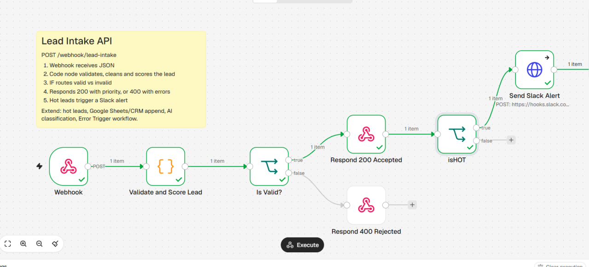
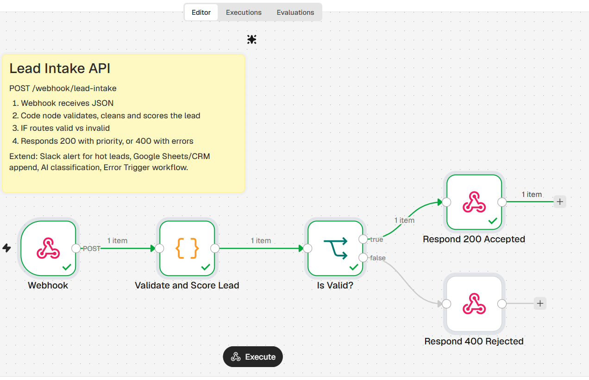
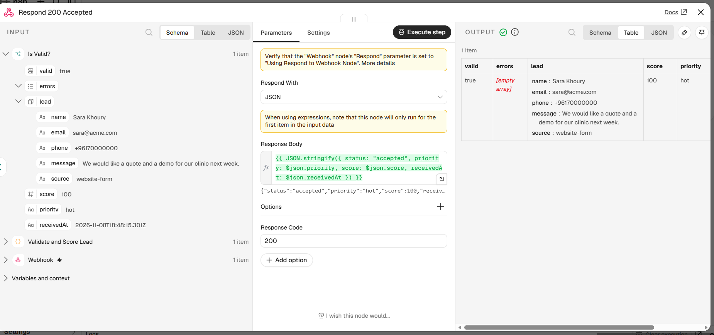
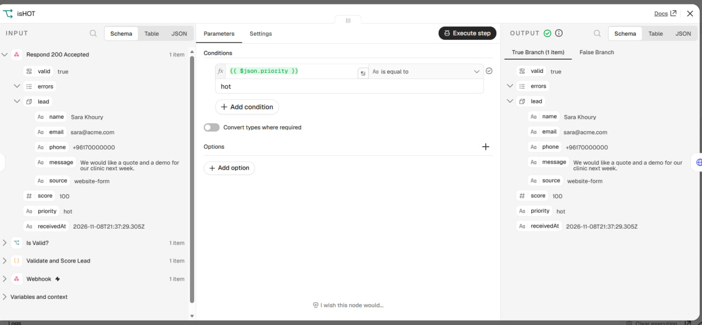
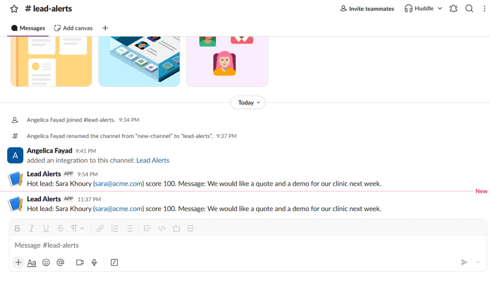
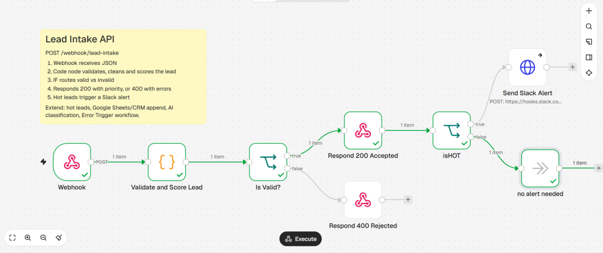
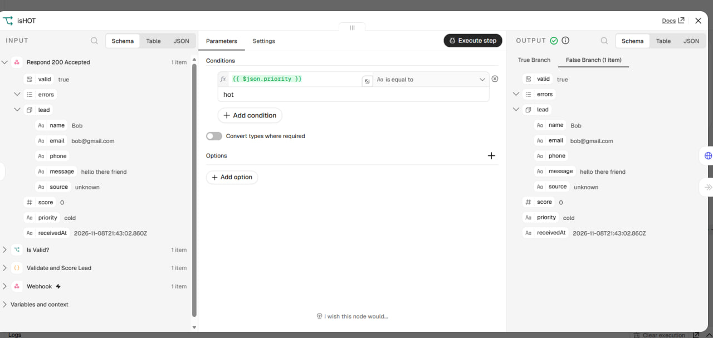
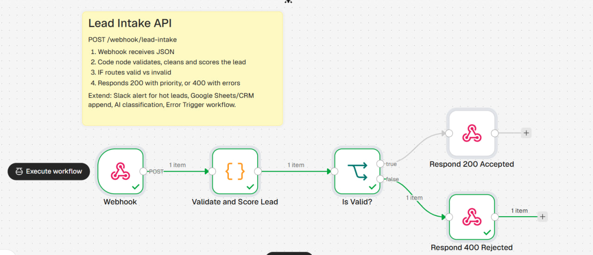
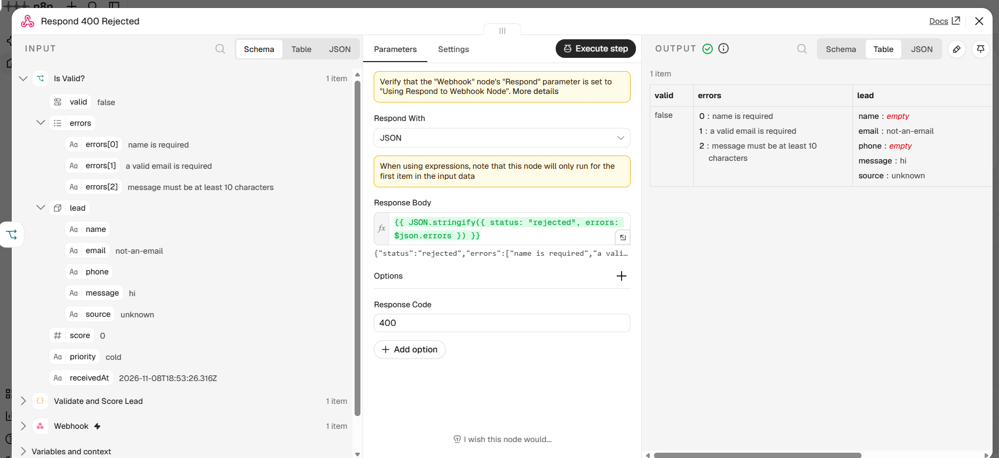
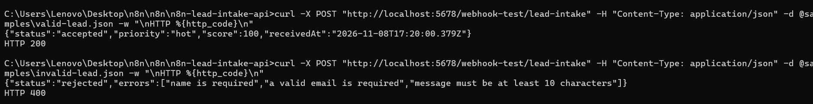

# Lead Intake Validation and Scoring API (n8n)

An n8n workflow that turns a webhook into a small API. It receives a lead as JSON, validates and cleans it, scores it with transparent rules, replies with the result, and sends a Slack alert for hot leads.

Built with AI assistance (Claude), then run, tested and reviewed by me.



## What it does

```
Webhook (POST)
   -> Validate and Score Lead (Code)
   -> Is Valid? (IF)
        true  -> Respond 200 Accepted -> isHOT (IF)
                                            true  -> Send Slack Alert (HTTP Request)
                                            false -> no alert needed
        false -> Respond 400 Rejected
```

1. **Webhook**: `POST /webhook/lead-intake`. The reply is sent by a Respond to Webhook node, so the caller gets the real result.
2. **Validate and Score Lead** (Code node): trims fields, lowercases the email, checks name, email format and message length, then scores the lead 0-100:
   - business email domain: +20
   - phone number given: +30
   - buying-intent words (price, quote, demo, book, urgent, buy): +30
   - message of 50+ characters: +20
   - priority: `hot` (70+), `warm` (40-69), `cold` (below 40)
3. **Is Valid?** (IF node): valid leads get HTTP 200 with priority and score; invalid ones get HTTP 400 with a list of errors.
4. **isHOT** (IF node): runs after the 200 response has been sent. If `priority` is equal to `hot`, the lead goes to the Slack step; otherwise it ends at `no alert needed`.
5. **Send Slack Alert** (HTTP Request node): posts a message to a Slack channel through an incoming webhook. It is set to continue on error, so a Slack failure never breaks the API response.

## Repository layout

| Path | Purpose |
|---|---|
| `workflows/lead-intake-workflow.json` | The n8n workflow (import this) |
| `samples/` | Example valid, invalid and cold payloads |
| `tests/test.sh` | Runs the sample requests (Git Bash / Linux / macOS) |
| `docs/` | Screenshots |
| `LICENSE` | MIT license |

## How to run it

1. Start n8n: `npx n8n` and open http://localhost:5678.
2. Workflows > Import from file > `workflows/lead-intake-workflow.json`.
3. Set up the Slack webhook (next section) and paste its URL into the `Send Slack Alert` node, replacing `YOUR_SLACK_WEBHOOK_URL`.
4. Click **Execute workflow**. The test URL listens for one call, so click it again before each request.
5. Send a request.

**Windows Command Prompt:**

```
curl -X POST "http://localhost:5678/webhook-test/lead-intake" -H "Content-Type: application/json" -d @samples\valid-lead.json -w "\nHTTP %{http_code}\n"
```

**Windows PowerShell** (use `curl.exe`, not `curl`):

```
curl.exe -X POST "http://localhost:5678/webhook-test/lead-intake" -H "Content-Type: application/json" -d "@samples\valid-lead.json" -w '\nHTTP %{http_code}\n'
```

**Git Bash / Linux / macOS:** `./tests/test.sh`

Use `samples/valid-lead.json`, `samples/cold-lead.json` or `samples/invalid-lead.json`.

## Expected results

| Sample | Response | Slack alert |
|---|---|---|
| `valid-lead.json` | HTTP 200, `{"status":"accepted","priority":"hot","score":100,...}` | Yes |
| `cold-lead.json` | HTTP 200, `{"status":"accepted","priority":"cold","score":0,...}` | No |
| `invalid-lead.json` | HTTP 400, `{"status":"rejected","errors":["name is required","a valid email is required","message must be at least 10 characters"]}` | No |

## Setting up the Slack alert

1. Create a Slack workspace and a channel, for example `#lead-alerts`.
2. At api.slack.com/apps choose **Create New App > From scratch**.
3. Open **Incoming Webhooks**, turn them on, and choose **Add New Webhook to Workspace**. Pick your channel.
4. Copy the webhook URL and paste it into the `Send Slack Alert` node in n8n.

The URL is a secret. It is not stored in this repo: the exported workflow contains the placeholder `YOUR_SLACK_WEBHOOK_URL`. If a real URL is ever committed by mistake, delete that webhook in Slack and create a new one.

## Screenshots

**Hot lead: the 200 branch runs and Slack is alerted**









**Cold lead: the 200 branch runs and no alert is sent**





**Invalid lead: the 400 branch runs**





**Terminal test results**



## What I learned

- How a webhook trigger works, and why "Respond to Webhook" mode is needed to return a custom status code.
- Writing and testing logic in the Code node, then routing results with IF nodes.
- Returning clear error messages from an API instead of failing silently.
- Calling an external service (Slack) through an incoming webhook, and keeping that call from breaking the main response by continuing on error.
- Debugging a real bug: my first `isHOT` condition used "exists" instead of "is equal to", so cold leads triggered alerts. I found it by checking the node's input and output, fixed the condition, and retested all three samples.
- Keeping secrets out of the repo by using a placeholder in the exported workflow.

## Next steps

- [x] Slack alert when `priority` is `hot`
- [ ] LLM step to classify intent or draft a reply
- [ ] Append each lead to Google Sheets or a CRM
- [ ] Error Trigger workflow to alert on failures

## Security

No credentials or webhook URLs are stored in this repo. Use n8n's credential manager or the placeholder approach for any keys you add.

## License

MIT. See [LICENSE](LICENSE).
